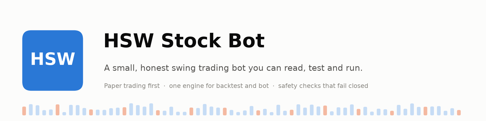
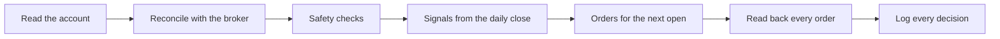
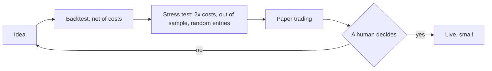
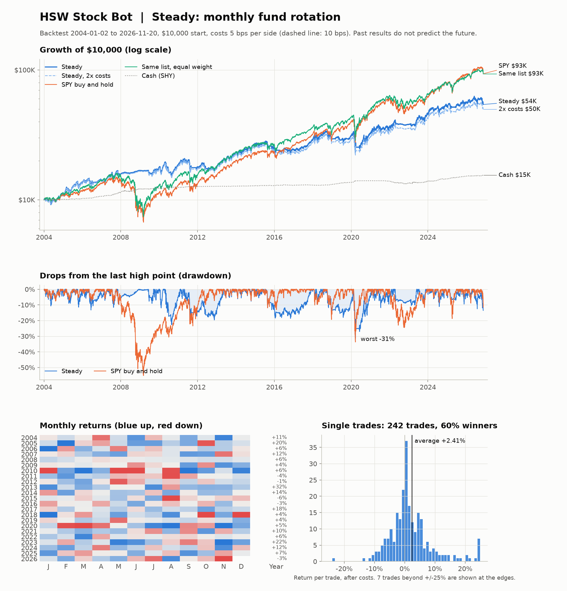
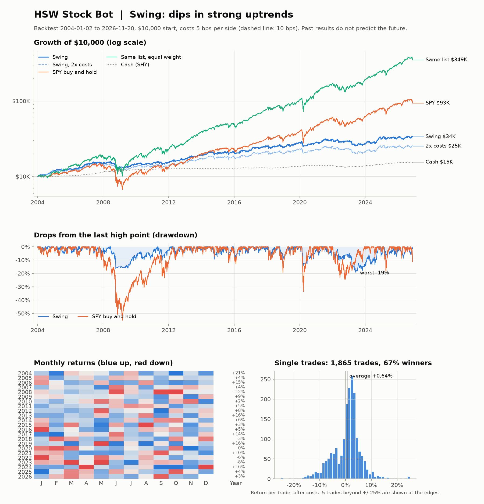
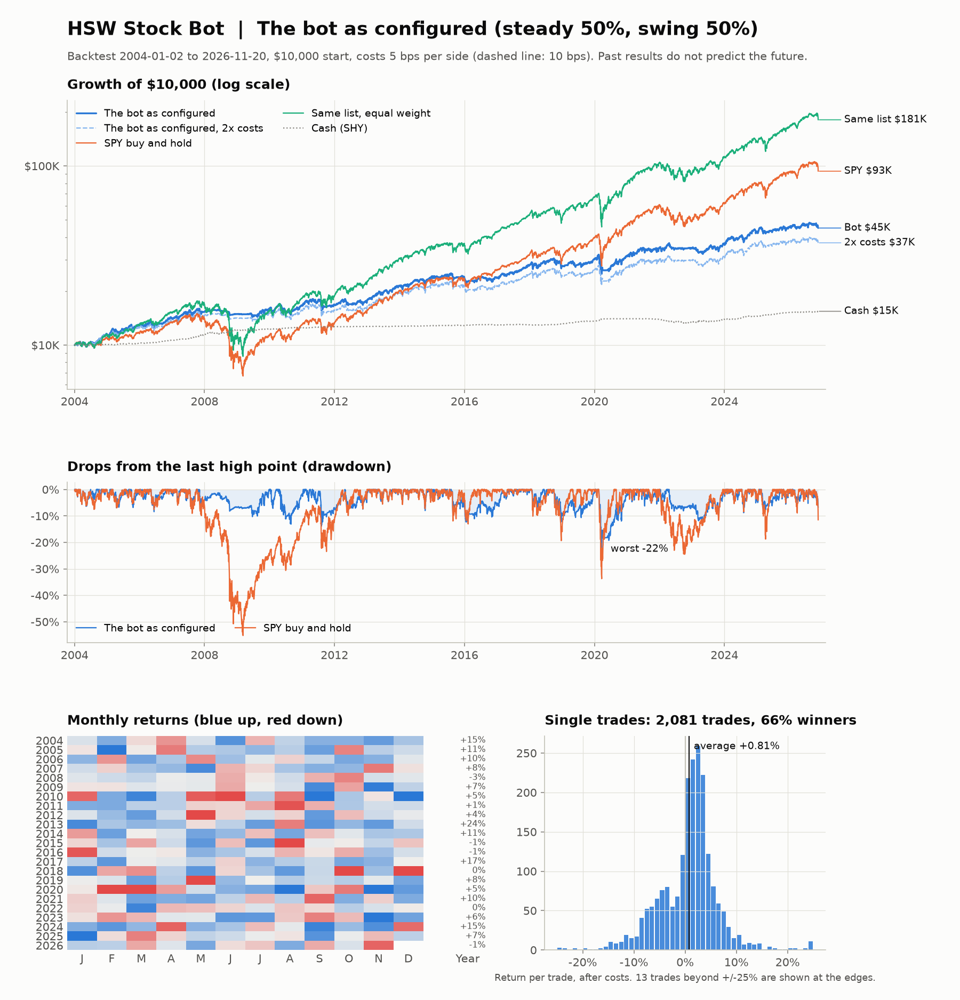

<p align="center">
  
</p>

# HSW Stock Bot

[](../../actions/workflows/ci.yml)


A small stock trading bot that runs by itself once a day. It scans a list of stocks and funds after the close. It decides what to buy and what to sell. Then it places the orders on an Alpaca account for the next open. It holds trades for days, weeks or months.

I built it for you to read, run and change. Every part is short and explained in plain words. Nothing is hidden.

> **Education only. This is not financial advice.** Start on a paper account. Stay there until you understand every line of the log.

<!-- report:headline:start -->
**In our backtest, no strategy beat simply holding SPY. However every strategy fell much less than SPY in the bad years.**
<!-- report:headline:end -->

## Contents

- [What this is](#what-this-is)
- [How it works](#how-it-works)
- [The two strategies](#the-two-strategies)
- [Results](#results)
- [Quick start in 5 minutes](#quick-start-in-5-minutes)
- [How the bot keeps your money safe](#how-the-bot-keeps-your-money-safe)
- [Make your own strategy](#make-your-own-strategy)
- [Beginner FAQ](#beginner-faq)
- [Honest limitations](#honest-limitations)
- [Project layout](#project-layout)
- [Disclaimer](#disclaimer)

## What this is

You told me what you wanted. A bot that trades on its own. It should look across many stocks, use small amounts of money, and make its picks from several different signals. It should hold trades for a few days, a few weeks, or even months. Small risk, and a small to medium reward.

This repo is my answer. It has three parts:

1. **Two strategies you can run today.**
   - **Steady** holds the 3 strongest of 15 stock funds and checks once a month. When the market trend turns down, it moves into a short term Treasury fund and waits.
   - **Swing** scans the 100 largest companies in the USA every evening. It buys sharp dips in strong uptrends. It sells on the bounce, at a stop loss, or after 20 trading days.
2. **A template** (`hsw_bot/strategies/my_strategy.py`) to build your own idea, with a step by step guide.
3. **A bot** that trades them on Alpaca. It uses paper money by default, and it stops itself when anything looks wrong.

The backtest and the live bot run the very same strategy code. That is the most important choice in the whole project. [How we trade](docs/HOW_WE_TRADE.md) explains why.

## How it works

Every trading day, after the close, the bot does one run:



The strategies only look at daily bars. They decide on the close of one day. The orders fill at the open of the next day. The backtest works exactly the same way, and it charges a cost on every buy and every sell.

Before any idea gets near real money, it goes through our pipeline:



## The two strategies

### Steady: monthly fund rotation (weeks to months)

- **What it can hold:** 15 funds. SPY, QQQ, IWM and MDY (big, tech, small and mid size companies), plus the 11 sector SPDR funds.
- **How it picks:** on the first trading day of each month it scores every fund by its average return over the last 3, 6 and 12 months. It holds the top 3, one third of the account each.
- **Trend filter:** if SPY scored worse than SHY (a fund of 1 to 3 year Treasury notes), the trend is down. Then it sells the stock funds and holds only SHY.
- **The idea behind it:** funds that went up tend to keep going for a while. That is called momentum. The trend filter tries to step aside during long bear markets.

### Swing: dips in strong uptrends (days to weeks)

- **What it scans:** the S&P 100, every evening.
- **When it buys:** the stock is in a strong uptrend, and it just had a sharp dip.
  - Uptrend: the close is above the 200 day average, and the 50 day average is above the 200 day average.
  - Dip: the close is below the lower Bollinger band (the 20 day average minus 2 standard deviations).
- **How it ranks:** when there are more dips than free slots, it ranks them with a score built from three different things. Momentum (the 6 month return). The depth of the dip. Calm (a small daily range compared with the price). Each counts the same.
- **When it sells,** at the next open after the first of these:
  - the stop: the close falls 3 average daily ranges (3 ATR) below the close on the day it decided to buy;
  - the bounce: the close is back above the 20 day average;
  - the time stop: it has held for 20 trading days.
- **How much it buys:** each trade risks about 1% of the account if the stop is hit. No stock gets more than 20% of the account. At most 5 stocks at a time.

Every number above lives in [`config.toml`](config.toml). I picked them from common conventions BEFORE the first backtest ran. I did not tune them afterward. Tuning numbers until a backtest looks good is the fastest way to fool yourself.

## Results

Every number in this section comes from `hsw-bot report`. I did not type a single one by hand. Run that command again later, and every table and chart here updates from fresh data.

<!-- report:summary:start -->
| Measure | Steady | Swing | The bot as configured | SPY buy and hold | Cash (SHY) |
| :--- | ---: | ---: | ---: | ---: | ---: |
| Yearly growth, normal costs | 7.7% | 5.4% | 6.8% | 10.3% | 1.9% |
| Yearly growth, 2x costs | 7.3% | 4.1% | 5.9% | n/a | n/a |
| Worst drop | -31.3% | -19.1% | -21.8% | -55.2% | -5.7% |
| Sharpe ratio | 0.56 | 0.57 | 0.64 | 0.62 | n/a |
| Yearly growth from 2015 (out of sample) | 6.2% | 4.2% | 5.5% | 12.5% | 1.6% |
| Its own list, equal weight: yearly growth | 10.2% | 16.8% | 13.5% | n/a | n/a |
| Random entry test, p value | 0.61 | 0.40 | n/a | n/a | n/a |

Tested from 2004-01-02 to 2026-11-20 with $10,000. Out of sample = from 2015-01-01.
<!-- report:summary:end -->

**Recent windows** (total return over each window):

<!-- report:recent:start -->
|  | Last 1 month | Last 6 months | Last 2 years | Full history |
| :--- | ---: | ---: | ---: | ---: |
| Steady, normal costs | -7.5% | -11.0% | +4.6% | +441.6% |
| Steady, 2x costs | -7.5% | -11.2% | +3.7% | +396.3% |
| Swing, normal costs | +3.2% | +4.1% | +1.5% | +235.1% |
| Swing, 2x costs | +3.1% | +3.5% | -1.0% | +151.5% |
| The bot as configured, normal costs | -3.7% | -4.3% | +4.2% | +349.9% |
| The bot as configured, 2x costs | -3.8% | -4.7% | +2.5% | +271.9% |
| Steady list, equal weight | -6.1% | -3.4% | +19.1% | +830.3% |
| Swing list, equal weight | -7.4% | +1.2% | +43.6% | +3387.5% |
| SPY buy and hold | -9.7% | -7.0% | +20.5% | +834.3% |
| Cash (SHY) | +0.4% | +1.2% | +7.2% | +54.3% |
<!-- report:recent:end -->

**What the numbers say, in plain words:**

<!-- report:verdicts:start -->
**Steady: monthly fund rotation.** Steady grew 7.7% a year after normal costs. SPY grew 10.3% a year. Therefore Steady did not beat simply holding SPY. However its worst drop was -31%, against -55% for SPY. Its Sharpe ratio was 0.56, against 0.62 for SPY. A gap that small is within the noise of the test. Therefore it earned about the same return for each unit of risk. Holding an equal weight portfolio of its own list grew 10.2% a year, more than Steady. Cash in SHY grew 1.9% a year, so Steady did beat cash over the full test. Over the last 2 years, it returned +4.6%, against +7.2% for cash. With double costs it still grew 7.3% a year. From 2015 on (out of sample) it grew 6.2% a year, against 12.5% for SPY. The random entry test gave p = 0.61. Therefore its trades were not clearly better than random trades of the same length. For Steady this test leans against it on purpose: the months it waits in the Treasury fund count as trades with small returns. Its value is the smaller drops, which is why the Sharpe ratio and the worst drop are shown too.

**Swing: dips in strong uptrends.** Swing grew 5.4% a year after normal costs. SPY grew 10.3% a year. Therefore Swing did not beat simply holding SPY. However its worst drop was -19%, against -55% for SPY. Its Sharpe ratio was 0.57, against 0.62 for SPY. A gap that small is within the noise of the test. Therefore it earned about the same return for each unit of risk. Holding an equal weight portfolio of its own list grew 16.8% a year, more than Swing. Cash in SHY grew 1.9% a year, so Swing did beat cash over the full test. Over the last 2 years, it returned +1.5%, against +7.2% for cash. With double costs it still grew 4.1% a year. From 2015 on (out of sample) it grew 4.2% a year, against 12.5% for SPY. The random entry test gave p = 0.40. Therefore its trades were not clearly better than random trades of the same length.

**The bot as configured (steady 50%, swing 50%).** The bot as configured grew 6.8% a year after normal costs. SPY grew 10.3% a year. Therefore the bot as configured did not beat simply holding SPY. However its worst drop was -22%, against -55% for SPY. Its Sharpe ratio was 0.64, against 0.62 for SPY. A gap that small is within the noise of the test. Therefore it earned about the same return for each unit of risk. Holding the same lists, in the same shares, grew 13.5% a year, more than the bot as configured. Cash in SHY grew 1.9% a year, so the bot as configured did beat cash over the full test. Over the last 2 years, it returned +4.2%, against +7.2% for cash. With double costs it still grew 5.9% a year. From 2015 on (out of sample) it grew 5.5% a year, against 12.5% for SPY.
<!-- report:verdicts:end -->

How to read the tables:

- **Yearly growth** is the CAGR: the steady yearly rate that turns the starting money into the final amount.
- **Worst drop** is the largest fall from a high point to a later low point (the max drawdown).
- **2x costs** is the stress test: every trade pays double the normal cost.
- **Same list** is an equal weight portfolio of the exact list the strategy picks from, topped back up once a month. It is the fair yardstick for Swing. The stock list is today's S&P 100, and that flatters every old result (see [Honest limitations](#honest-limitations)).
- **Cash (SHY)** is a fund of short Treasury notes, bought and held. It is the "do nothing" yardstick. A strategy that earns less than this over a stretch would have done better sitting in cash.
- **The bot as configured** runs Steady and Swing together in one account, each with its share from `config.toml`, through the same sizing code as the live bot. That is what `hsw-bot run` really does.
- **Out of sample** is the stretch from 2015 on. The settings were fixed before I looked at any of it.
- **Sharpe ratio** is the return earned for each unit of risk (ups and downs). Higher is better. A strategy can grow more slowly than SPY and still have a similar Sharpe ratio, if it falls much less.
- **Random entry p value**: we built thousands of random traders who made the same number of trades, held for the same lengths, but bought random stocks from the same list on random days. The p value is the share of them that did as well as the strategy. Below 0.05 would mean "hard to explain by luck". For Steady this test leans against it on purpose: its months in the Treasury fund count as trades with small returns. Its value is the smaller drops, which is why the Sharpe ratio and the worst drop are shown too.

<p align="center">
  
</p>

<p align="center">
  
</p>

<p align="center">
  
</p>

The full tables are in [docs/RESULTS.md](docs/RESULTS.md): both cost levels, in sample against out of sample, year by year, and the worst stretches.

<!-- report:data:start -->
Daily bars from Yahoo Finance (adjusted for splits and dividends), 2002-01-02 to 2026-11-20. Downloaded 2026-11-21 23:06 UTC. Data end date: 2026-11-20.
<!-- report:data:end -->

## Quick start in 5 minutes

You need Python 3.12 and git. The commands below are for Linux and Mac. Windows notes are in [the Alpaca setup guide](docs/SETUP_ALPACA.md#windows).

**1. Install** (about 1 minute)

```bash
git clone <this repo's url> hsw-stock-bot
cd hsw-stock-bot
python3.12 -m venv .venv
source .venv/bin/activate
pip install -r requirements.txt
pip install -e . --no-deps
pytest                       # about 170 offline tests; they should all pass
```

**2. Backtest** (the first run downloads about 25 years of daily bars, roughly a minute)

```bash
hsw-bot backtest                     # both strategies, normal costs
hsw-bot backtest --cost-mult 2       # the stress test: double costs
hsw-bot report                       # rebuild every number and chart in the docs
```

**3. Dry run** (real data, a pretend broker, no keys needed)

```bash
hsw-bot dry-run
```

It prints the exact orders the bot would send tonight, and why. Nothing is sent anywhere.

**4. Paper trading** (pretend money at Alpaca)

Make a free Alpaca account and copy your PAPER keys. [docs/SETUP_ALPACA.md](docs/SETUP_ALPACA.md) shows where to find them.

```bash
cp .env.example .env      # then paste your paper keys into .env
hsw-bot run               # one paper run (after the close)
hsw-bot status            # what the account holds, and the safety switches
hsw-bot no-margin         # optional: set the account so it can never borrow
```

**5. Schedule it** (hands off, once a day)

```bash
crontab -e
# add this line: 6:30 PM, Monday to Friday (set the hour for your time zone)
30 18 * * 1-5 cd /path/to/hsw-stock-bot && .venv/bin/hsw-bot run >> logs/cron.log 2>&1
```

Windows Task Scheduler steps are in [the setup guide](docs/SETUP_ALPACA.md#4-run-it-every-day-by-itself).

## How the bot keeps your money safe

| Safety feature | What it does |
| :--- | :--- |
| Paper by default | The bot trades pretend money unless you flip TWO separate switches: `ALPACA_PAPER=false` in `.env` AND the `--live` flag. One alone is refused. |
| Keys stay secret | Keys come only from `.env` (which git ignores) or your environment. The bot never prints or logs them. |
| One record per account | Paper and live keep separate records (`state/paper/`, `state/live/`), and each record file names its one account. Records from another account are refused. |
| Lost records | If the records are missing while the account holds stocks or orders, the bot refuses to trade. `hsw-bot rebuild-state` rebuilds them from Alpaca's order history, carefully: it replays every fill, yours and the bot's, and it does not claim a stock you traded by hand after the bot's last fill. It prints what it claimed, what it did not, and why. A normal run never takes a position from the order history. |
| Never sells your shares | The bot only ever sells shares its records say it bought. If you add shares by hand, it sells only its own and buys no more of that stock. Stocks you list in `bot.ignore_symbols` are never touched. |
| Never borrows | Buys only spend cash the account already has. Money from a sell is spent on the next run, after the sell has filled. If cash is ever below zero, no new buys. |
| Fails closed | If the account, the positions, the open orders, the clock or the market calendar cannot be read, or look wrong, the bot sends NO orders and exits with code 2. From the second failed run in a row it warns loudly, because nothing protects open positions while it is stopped. |
| Sells only | If only some prices are bad, the bot still checks the exits of every stock with a good price, leaves the others alone, makes no new buys, and asks for a look. |
| Kill switch | A file named `stop` in the bot folder (any case, any extension: `STOP`, `stop.txt`) means no new buys. The bot still sells on its normal rules, so it can wind down. |
| Daily loss limit | If the account fell 3% or more since the previous close, no new buys this run, and the run asks for a look. The previous close comes from Alpaca's daily account history, or Alpaca's previous close value when its date is right, or the bot's own run that evening. Never from today. If none can be trusted, no new buys either. |
| Drawdown limit | If the account falls 20% below its best level, the bot writes the `STOP` file itself. A human must look before it buys again. Deposits and withdrawals move the best level with them, so moving money never counts as a gain or a loss. `hsw-bot reset-peak` sets a new best level by hand. |
| No double buys | Every decision gets the same order id (for example `hsw-swing-20261120-AAPL-buy`). The bot checks its positions, its open orders and its records first. A second run the same evening sends nothing new. |
| Written before sent | Each order goes into the records before it is sent. If the answer is lost, the bot asks the broker by order id, and the next run checks again. A position the bot bought is never left untracked. |
| Read back | An "accepted" order is not a fill. The next run asks the broker what really filled, and only then records the position. A sell that did not go through (refused, not filled, or lost on the way) is sent again by the next run, with a new order id, even if that stock's price bar is bad. After 3 failed tries the bot warns loudly. |
| Bug guards | Last checks before sending: no order over its size cap, no selling more than the bot owns, no buys beyond the cash, no buying and selling one stock in one run. The market clock is checked again right before sending. |
| A full journal | Every decision, order, fill, mismatch and safety stop goes into `logs/journal.csv`. Every run prints one status line: mode, account (masked), kill switch, and positions managed, ignored and unmanaged. |

Exit codes, for scripts and schedulers:

| Code | Meaning |
| :--- | :--- |
| `0` | Fine. |
| `1` | Finished, but something needs a look: an order refused or not filled, a mismatch with the broker, a position the bot did not open, a sells only run, the daily loss limit, or deposits and withdrawals that could not be read. Or the run stopped AFTER sending orders; it then says how many. |
| `2` | Failed closed. Nothing was sent. |
| `3` | A setup problem: settings or keys. |

## Make your own strategy

Copy [`hsw_bot/strategies/my_strategy.py`](hsw_bot/strategies/my_strategy.py). It is a small working example with comments on every part. Then follow [docs/MAKE_YOUR_OWN.md](docs/MAKE_YOUR_OWN.md). It walks you through writing the rules, adding the settings, running the backtest, the stress test and the guard tests, and only then paper trading.

## Beginner FAQ

**Will this make me money?**
Nobody can promise that, and I will not. The [results](#results) say plainly whether each strategy beat simply holding SPY, and how far each one fell in the bad years. Read them before you decide anything.

**Then why not just buy SPY and hold it?**
That is a fair choice, and for many people it is the best one. However SPY fell more than half in 2008 and 2009. Most people sell in a fall like that, at the worst time. The strategies here trade some growth for smaller falls. You decide what fits you.

**How much money do I need?**
The bot buys in dollars, and Alpaca allows fractional shares. So a small account can still hold several positions. The backtest starts with $10,000, but the percentages work the same for smaller amounts. Orders under $10 are skipped.

**Does it day trade?**
No. It buys at the open and sells at a later open, so it never buys and sells the same stock on the same day.

**Can it short stocks or borrow money?**
No. It only buys stocks and funds, and it only spends the cash it has.

**What if my computer is off one evening?**
Nothing bad happens. Steady catches up on the next run. Swing only acts on that evening's dips, so it may miss a trade. A sell that was due simply happens one day later.

**Can I run both strategies at once?**
Yes. By default each one gets half of the account (`[bot] sleeves` in `config.toml`). The results show each strategy alone, and also "the bot as configured": both together, the way the bot really runs them.

**I bought some stocks by hand in the same account. Is that a problem?**
The bot never touches positions it did not open. It asks for a look until you list them in `bot.ignore_symbols` in `config.toml`. After that it skips them quietly.

**Can I add money or take some out?**
Yes. Each run reads Alpaca's list of deposits and withdrawals, and moves the best level with them. So moving money never trips the drawdown limit, and it never hides a real loss. On the evening of a withdrawal bigger than 3% of the account, the daily loss limit sees a "fall" and stops new buys once, and asks for a look. That is expected; buys start again the next evening.

**What does "fail closed" mean?**
When something is wrong or unclear, the safe choice is to do nothing. A door that fails closed stays locked when the power goes out.

**What about taxes?**
Every sale can be a taxable event, and Swing makes many short trades. Keep the journal. Ask a tax professional.

## Honest limitations

- **Today's stock list flatters the past.** The S&P 100 list in `config.toml` is today's list. Those companies are in it because they grew. A backtest that trades them in 2005 quietly knows who would win. That is called survivorship bias, and it makes every old stock result look better than reality. The "same list" baseline has the same bias, so compare Swing with it first. [How we trade](docs/HOW_WE_TRADE.md#survivorship-bias) explains this.
- **A backtest is not the future.** Expect real results to be clearly worse than any backtest.
- **Stops are checked once a day.** A stock can open far below its stop after bad news. The backtest includes those gaps, because it also sells at the next open. However a single bad gap can still cost more than the planned 1%.
- **The data is free and unofficial.** Yahoo Finance through `yfinance` can be late, wrong or briefly broken. The bot refuses to trade on missing or stale bars. Old prices of companies that split off a business can contain odd jumps.
- **Costs are an estimate.** We charge 0.05% on every buy and every sell, then double it in the stress test. Real costs move with the market.
- **Paper trading is not real trading.** Alpaca's paper account fills against live quotes, but it does not model the effect of your own orders, and it does not pay dividends.
- **Monthly checks are slow in fast crashes.** In early 2020 the market fell faster than a monthly trend filter can react.
- **Cash earns nothing in the backtest, and there are no taxes in it.**
- **We have never run this bot with real money.** The fake broker tests cover every safety rule. However the first real test is your own paper account.

## Project layout

```text
config.toml              every setting, in one file
hsw_bot/
  config.py              reads and checks config.toml
  data.py                downloads daily bars (Yahoo Finance), checks them
  strategies/            Steady, Swing, and the my_strategy template
  planner.py             sizing and the daily plan: shared by backtest AND bot
  engine.py              the backtest: decide at the close, fill at the next open
  stats.py               scores, baselines, random entry test, drawdowns
  broker/                Alpaca (paper or live) and a fake broker for tests
  runner.py              one bot run, with every safety check
  state.py, journal.py   the bot's records and its CSV journal
  rebuild.py             order ids, and rebuilding lost records from the broker
  report.py, charts.py   rebuild every number, table and chart in the docs
  cli.py                 the hsw-bot command
tests/                   about 170 offline tests, including the five guards
docs/                    how we trade, Alpaca setup, make your own, full results
```

## Disclaimer

This project is for education only. It is not financial advice, and nothing here is a recommendation to buy or sell anything. Trading can lose money, including more than you expect. Past results, real or backtested, do not predict future results. The code comes with no warranty of any kind. If you trade real money with it, you do so at your own risk.

## License

[MIT](LICENSE). Use it, change it, share it.
