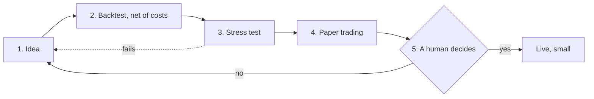
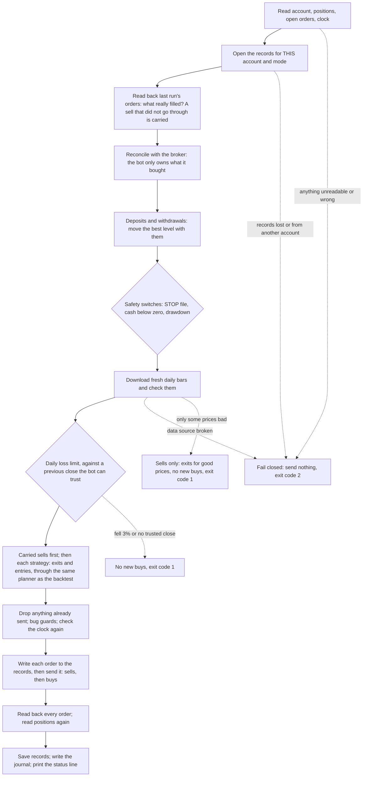

# How we trade

This is how we at HSW take a trading idea from a hunch to real money. It is slow on purpose. Every step exists because skipping it has cost somebody money.

## 1. The idea

Write the rule down in plain words before you write any code. "Buy strong stocks after a sharp dip, sell on the bounce." If you cannot say it in two sentences, it is not ready.

Pick the settings from common sense or common practice. Then freeze them. Do not change them after you see a result. Every time you change a number because the backtest looked better, the backtest becomes a little more fiction.

## 2. The backtest, net of costs

A backtest replays history one day at a time and asks: "what would these rules have done?"

Ours follows three hard rules:

- **Decide at the close, fill at the next open.** On the evening of day t, the strategy sees day t's close and nothing later. Its orders fill at the open of day t+1. This is exactly what the live bot does.
- **Every trade pays.** Each buy fills a little above the open and each sell a little below it. We charge 0.05% per side by default (`slippage_bps` in `config.toml`). Alpaca charges no commission, but the spread and slippage are real.
- **One engine.** There is one backtest engine (`hsw_bot/engine.py`) and one planner (`hsw_bot/planner.py`). The live bot calls the same planner with the same strategy code. We never write the strategy twice, because two copies always drift apart, and then the backtest describes a bot you are not running.

## 3. The stress test

A good looking backtest is where the work starts, not where it ends. Every result in [RESULTS.md](RESULTS.md) goes through these checks:

| Test | The question it answers |
| :--- | :--- |
| Double costs | Does the edge survive if trading costs twice what we expect? |
| Two baselines | Does it beat SPY buy and hold? Does it beat an equal weight portfolio of its own list? |
| Out of sample | The settings were fixed first. How did it do on the years after 2015, which played no part in choosing them? |
| Random entries | Thousands of random traders make the same number of trades, with the same holding lengths, on random stocks from the same list. Did the strategy beat most of them? |
| Recent windows | What happened in the last month, 6 months and 2 years, not just over 20 years? |

### Survivorship bias

The Swing strategy trades today's S&P 100. Those 100 companies are on the list because they grew. In 2005 nobody knew that. So a backtest on today's list quietly knows the winners in advance. It looks better than anything you could really have done.

We cannot fully fix this with free data. However we can cancel most of it. The "same list" baseline buys every stock on the same list in equal amounts and tops them back up once a month. It has exactly the same unfair advantage. So the fair question is not "did Swing beat SPY?" but "did Swing beat its own list?" If a strategy only beats SPY, the list did the work, not the rules.

### What a p value means here

The random entry test gives a p value: the share of random traders who did at least as well as the strategy. A p value of 0.5 means half of the random traders matched it, so the picks added nothing we can measure. Below 0.05 means fewer than 1 in 20 random traders matched it. That is hard to explain by luck alone. It is still not proof.

## 4. Paper trading

Paper trading uses pretend money at a real broker with real prices. It tests the parts a backtest cannot: the data arriving on time, the orders being accepted, the fills, the logs, your schedule, and your own nerves.

Run the bot on paper for at least a few weeks. Read `logs/journal.csv` after every run. Compare what the bot did with what the backtest says it should have done. They should match closely. If they do not, find out why before anything else.

## 5. A human decides

The bot never promotes itself to real money. Going live needs two separate switches, set by you on purpose (see [SETUP_ALPACA.md](SETUP_ALPACA.md#going-live)). Start small. A good rule of thumb: expect live results to be clearly worse than the backtest, and size for that.

## The guard tests

Five automatic tests guard the engine. They run on made up data with a fixed random seed, so they need no internet and give the same answer every time. Each one catches a classic way a backtest lies:

| Guard | What it catches | File |
| :--- | :--- | :--- |
| Golden baseline | A tiny six day market whose result we worked out by hand. Any change in the math shows up at once. | `tests/test_guard_golden.py` |
| No NaN | A missing price that silently poisons the equity curve or an order size. | `tests/test_guard_finite.py` |
| Cost monotonic | A cost model with a sign error: more cost must always mean less money. | `tests/test_guard_costs.py` |
| No lookahead | Peeking at tomorrow. Cutting off or scrambling the future must not change the past. | `tests/test_guard_lookahead.py` |
| Reconciliation | Money appearing or vanishing: trade profits plus open positions must equal the change in equity, to the cent. | `tests/test_guard_reconciliation.py` |

We test the tests, too. A guard that never fails is worth nothing. So `python -m tests.plant_bugs` copies the code to a temporary folder, breaks it on purpose in one place, and checks that the matching guard fails. The planted bugs: tomorrow's price in an indicator, buys filled on the decision day, sells charged the wrong way, a commission left out of the cash, a missing price not carried forward, and a buy that pays a tiny bit too much. Every one is caught.

## How one bot run works

### Safety guards fail closed

When the bot cannot read something it needs, or the numbers look wrong, it does nothing and says why. It never guesses. A missed trading day costs little. A trade made on a stale price, a wrong balance or a half downloaded file can cost a lot. That is the whole philosophy in one line: **when in doubt, do nothing, and make noise.**

However doing nothing is only safe for a short while. Nothing rests at the broker, so while the bot is stopped, its open positions have no stop loss. From the second failed run in a row, the bot says so loudly. Fix the cause, or manage the positions by hand.

Not every problem needs a full stop. If only some prices are bad, the bot runs in "sells only" mode. It still checks the exits of every stock with a good price, leaves the others alone, buys nothing new, and exits with code 1 so you look at it.

### The bot's records

The broker knows what the account holds. The bot also needs to know why: which strategy bought each stock, and on which evening. So it keeps small records next to the code:

- Paper and live keep separate records (`state/paper/`, `state/live/`). Each file names the one account it belongs to. Records from another account are refused.
- The bot only ever sells shares its records say it bought. If you add shares of the same stock by hand, those are yours: the bot sells only its own, and it buys no more of that stock.
- Positions enter the records only from the bot's own orders: each order is written down before it is sent, and its fill is read back later. A run never takes a position from the order history. A position that is not in the records is "unmanaged": the bot never touches it, and it asks for a look.
- If the records go missing while the account holds stocks or orders, the bot refuses to trade. `hsw-bot rebuild-state` rebuilds them from Alpaca's order history. Every order id carries the strategy, the decision day, the stock and the side. Even so the rebuild is careful. It replays every fill in each stock, yours and the bot's, in time order. After each fill it caps the bot's shares at what the account really held. If you traded a stock by hand after the bot's last fill in it, the rebuild does not claim that stock at all, because it cannot know whose shares you traded. It prints a table of what it claimed, what it did not, and why.
- The rebuild never guesses the best level for the drawdown limit. You choose it: `--peak <dollars>` or `--peak-now`.
- Stocks you hold by hand go in `bot.ignore_symbols` in `config.toml`. The bot never buys, sells or warns about them.

### Never borrow

The bot only spends cash the account already has. The money from a sell is NOT spent on the same evening, because the sell only fills at the next open and the cash settles a day after that. It is spent on the next run. So a rotation buys its new fund one day after selling the old one. The backtest follows the same rule, because both use the same planner.

### Never trust an order acknowledgment

When a broker says "accepted", it only means "we received your order". It does not mean you own the stock. Orders sent after the close wait until the next open, and then they may fill, fill partly, or be refused.

So the bot keeps two separate ideas:

- **pending:** orders sent but not yet confirmed;
- **positions:** shares the broker says we own, at the price the broker says we paid.

Each order is written to the records BEFORE it is sent. If the connection drops while sending, the bot asks the broker by order id whether it arrived, and the next run asks again. A pending order becomes a position only when a later run reads the broker's filled quantity and average price.

A sell that did not go through is "carried". That covers a sell the broker refused, one that ended canceled or expired, and one that never reached the broker. The next run sends it again, without judging it again. It goes out even when that stock's price bar is bad, because a market order for the next open needs no fresh price. Each try gets a new order id (`...-sell-r1`, `...-sell-r2`), because a broker may refuse an id it has seen before. Every failure asks for a look. After 3 failed tries the bot warns loudly: until the sell goes through, that position has no working exit.

### The daily loss limit

The limit compares the account now with the account at the previous close. That previous close must be the right one. A number from today would always show 0%, and the limit would never trip. So the bot takes it from the first of these that it can trust:

1. Alpaca's daily account history, the value for the previous trading day;
2. Alpaca's "previous close" value (`last_equity`), but only when its date is the previous trading day;
3. the account value the bot saved after its own good run that evening.

If none of them can be trusted, there are no new buys that run. Any daily loss stop asks for a look (exit code 1).

### Deposits and withdrawals

The drawdown limit compares the account with its best level. A withdrawal is not a loss, and a deposit is not a gain. So each run reads Alpaca's list of deposits, withdrawals and transfers, and moves the best level by the same factor as the account. Say the best level was $10,000 and you take out $2,500 at the top. The account is $7,500, and the best level becomes $7,500 too. The drawdown stays at 0%. Each movement counts once. If the list cannot be read, the bot cannot tell a withdrawal from a loss, so there are no new buys that run.

Shares moved in or out (a transfer from another broker, for example) have no reliable dollar value in that list. The bot does not guess. It asks for a look, and you can set a new best level with `hsw-bot reset-peak`.

### Exit codes

| Code | Meaning |
| :--- | :--- |
| `0` | Fine. |
| `1` | Finished, but something needs a human look: a refused or unfilled order, a mismatch, an unmanaged position, a sells only run, the daily loss limit. The journal says what. |
| `2` | Failed closed. Nothing was sent. |
| `3` | A setup problem: settings or keys. |
