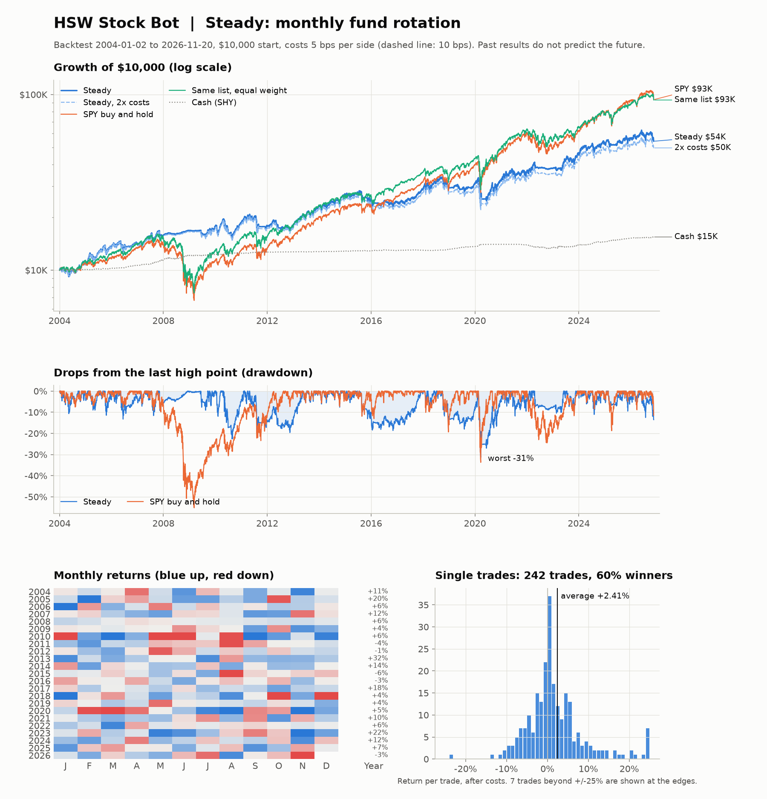
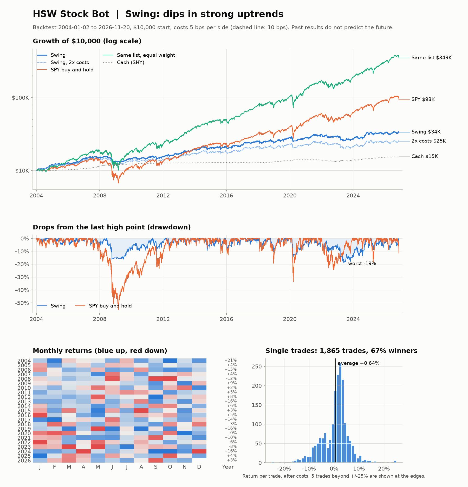
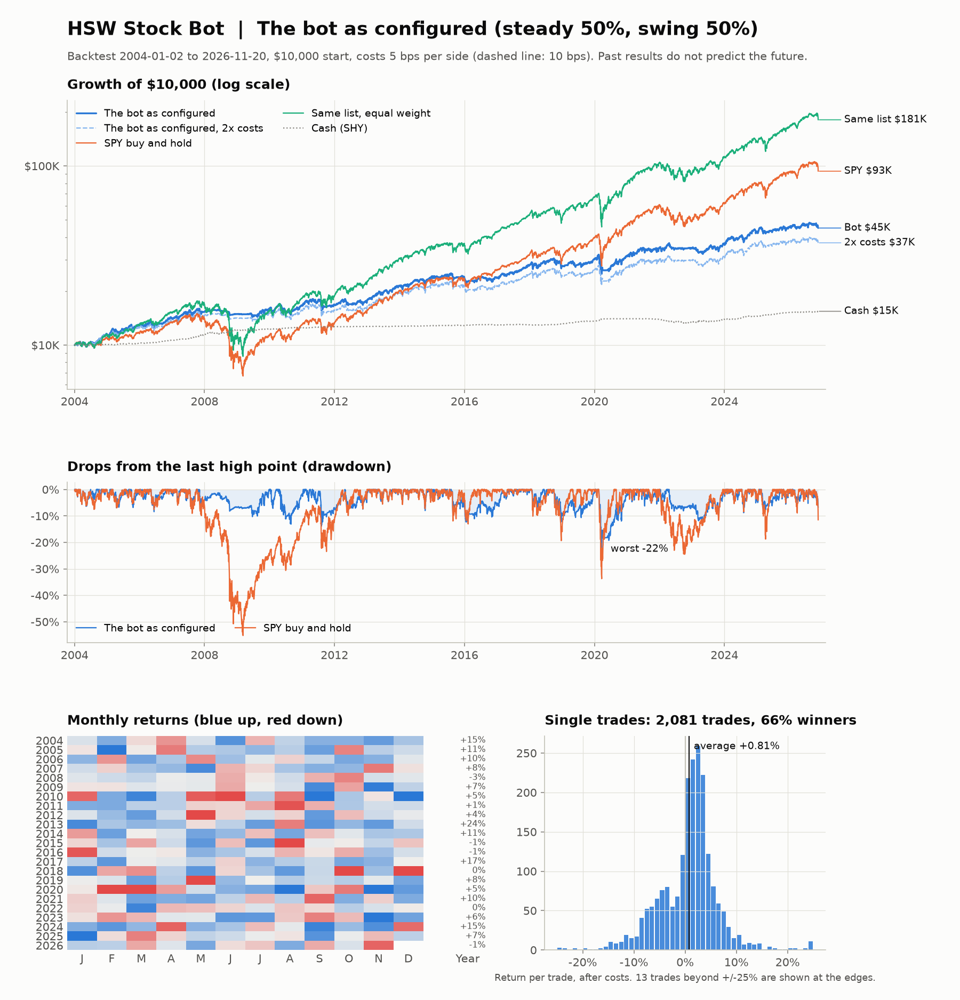

# Results

Every number on this page is written by `hsw-bot report`. I did not type any of them. To rebuild the whole page from fresh data:

```bash
hsw-bot report --refresh
```

Two promises about these numbers:

- **The settings were fixed before the first backtest ran,** and they were not changed after any result. The exact settings are listed at the bottom of this page.
- **Nothing is hidden.** If a strategy lost to simple buy and hold, the page says so in plain words.

Read [How we trade](HOW_WE_TRADE.md) first if a term here is new to you. Remember that a backtest is a story about the past. It is not a forecast.

<!-- report:data:start -->
Daily bars from Yahoo Finance (adjusted for splits and dividends), 2002-01-02 to 2026-11-20. Downloaded 2026-11-21 23:06 UTC. Data end date: 2026-11-20.
<!-- report:data:end -->

## Steady: monthly fund rotation

### In plain words

<!-- report:steady-verdict:start -->
Steady grew 7.7% a year after normal costs. SPY grew 10.3% a year. Therefore Steady did not beat simply holding SPY. However its worst drop was -31%, against -55% for SPY. Its Sharpe ratio was 0.56, against 0.62 for SPY. A gap that small is within the noise of the test. Therefore it earned about the same return for each unit of risk. Holding an equal weight portfolio of its own list grew 10.2% a year, more than Steady. Cash in SHY grew 1.9% a year, so Steady did beat cash over the full test. Over the last 2 years, it returned +4.6%, against +7.2% for cash. With double costs it still grew 7.3% a year. From 2015 on (out of sample) it grew 6.2% a year, against 12.5% for SPY. The random entry test gave p = 0.61. Therefore its trades were not clearly better than random trades of the same length. For Steady this test leans against it on purpose: the months it waits in the Treasury fund count as trades with small returns. Its value is the smaller drops, which is why the Sharpe ratio and the worst drop are shown too.
<!-- report:steady-verdict:end -->

### Full history

<!-- report:steady-full:start -->
Full history, 2004-01-02 to 2026-11-20, starting with $10,000.

| Measure | Steady, normal costs | Steady, 2x costs | SPY buy and hold | Same list, equal weight | Cash (SHY) |
| :--- | ---: | ---: | ---: | ---: | ---: |
| Yearly growth (CAGR) | 7.7% | 7.3% | 10.3% | 10.2% | 1.9% |
| Total return | 442% | 396% | 834% | 830% | 54% |
| Worst drop (max drawdown) | -31.3% | -32.0% | -55.2% | -53.9% | -5.7% |
| Sharpe ratio | 0.56 | 0.53 | 0.62 | 0.62 | n/a |
| Yearly volatility | 15.5% | 15.5% | 18.6% | 18.3% | 1.5% |
| Trades | 242 | 242 | 1 | monthly top ups | 1 |
| Win rate | 60.3% | 57.4% | n/a | n/a | n/a |
| Trades per month | 0.9 | 0.9 | n/a | n/a | n/a |
| Average hold (trading days) | 61.8 | 61.8 | n/a | n/a | n/a |
| Time in the market | 96% | 96% | 100% | 100% | 100% |
<!-- report:steady-full:end -->

### Recent windows

Each window is cut out of the one continuous backtest, so positions carry in from before it.

<!-- report:steady-windows:start -->
| Window | Return, normal costs | Return, 2x costs | Worst drop | SPY return | SPY worst drop | Same list return | Cash (SHY) return |
| :--- | ---: | ---: | ---: | ---: | ---: | ---: | ---: |
| Last 1 month (2026-10-23 to 2026-11-20) | -7.5% | -7.5% | -10.2% | -9.7% | -10.7% | -6.1% | +0.4% |
| Last 6 months (2026-05-26 to 2026-11-20) | -11.0% | -11.2% | -13.5% | -7.0% | -11.5% | -3.4% | +1.2% |
| Last 2 years (2024-11-18 to 2026-11-20) | +4.6% | +3.7% | -13.5% | +20.5% | -18.8% | +19.1% | +7.2% |
| Full history (2004-01-02 to 2026-11-20) | +441.6% | +396.3% | -31.3% | +834.3% | -55.2% | +830.3% | +54.3% |
<!-- report:steady-windows:end -->

### In sample and out of sample

The settings were fixed before any test. The years from 2015 on played no part in choosing them.

<!-- report:steady-split:start -->
| Period | Yearly growth | With 2x costs | Worst drop | Sharpe | SPY yearly growth | SPY worst drop | Same list yearly growth | Cash (SHY) yearly growth |
| :--- | ---: | ---: | ---: | ---: | ---: | ---: | ---: | ---: |
| In sample (2004-01-02 to 2014-12-31) | 9.3% | 8.9% | -22.6% | 0.68 | 7.8% | -55.2% | 9.3% | 2.3% |
| Out of sample (2015-01-02 to 2026-11-20) | 6.2% | 5.7% | -31.3% | 0.45 | 12.5% | -33.7% | 11.1% | 1.6% |
<!-- report:steady-split:end -->

### Random entry test

<!-- report:steady-random:start -->
| Trades | Strategy: average per trade | Random traders: average | Random traders: middle 90% | p value |
| :--- | ---: | ---: | ---: | ---: |
| 242 | +2.41% | +2.57% | +1.64% to +3.50% | 0.606 |

2,000 random traders. Each made the same 242 trades with the same holding lengths, but on random stocks from the same list and random days. For Steady this test leans against it on purpose: the months it waits in the Treasury fund count as trades with small returns. Its value is the smaller drops, which is why the Sharpe ratio and the worst drop are shown too.
<!-- report:steady-random:end -->

### The worst stretches

<!-- report:steady-stretch:start -->
Steady had its worst drop from 2018-10-01 to 2020-03-23: -31.3% from its high. It was back at the old high on 2021-01-25, about 28 months after the drop began.
<!-- report:steady-stretch:end -->

<!-- report:steady-drawdowns:start -->
| High point | Low point | Back to the high | Drop |
| :--- | :--- | :--- | :--- |
| 2018-10-01 | 2020-03-23 | 2021-01-25 | -31.3% |
| 2010-04-23 | 2010-08-24 | 2011-02-07 | -22.6% |
| 2011-04-29 | 2011-08-08 | 2013-05-15 | -19.8% |
<!-- report:steady-drawdowns:end -->

### Year by year

<!-- report:steady-years:start -->
| Year | Strategy | With 2x costs | SPY | Same list | Cash (SHY) | Beat SPY? |
| :--- | ---: | ---: | ---: | ---: | ---: | ---: |
| 2004 | +10.9% | +10.6% | +10.2% | +13.6% | +0.7% | yes |
| 2005 | +19.9% | +19.6% | +4.8% | +7.3% | +1.5% | yes |
| 2006 | +6.4% | +5.9% | +15.8% | +15.2% | +3.9% | no |
| 2007 | +11.6% | +11.2% | +5.1% | +8.8% | +7.4% | yes |
| 2008 | +6.5% | +6.5% | -36.8% | -36.0% | +6.6% | yes |
| 2009 | +4.5% | +4.0% | +26.4% | +30.8% | +0.4% | no |
| 2010 | +5.7% | +5.2% | +15.1% | +17.9% | +2.3% | no |
| 2011 | -3.8% | -4.2% | +1.9% | +2.1% | +1.4% | no |
| 2012 | -0.8% | -1.3% | +16.0% | +15.5% | +0.3% | no |
| 2013 | +31.8% | +31.3% | +32.3% | +32.2% | +0.2% | no |
| 2014 | +13.8% | +13.5% | +13.5% | +12.9% | +0.4% | yes |
| 2015 | -6.0% | -6.3% | +1.2% | -0.4% | +0.4% | no |
| 2016 | -3.1% | -3.6% | +12.0% | +13.9% | +0.8% | no |
| 2017 | +18.2% | +17.9% | +21.7% | +19.2% | +0.3% | no |
| 2018 | +4.3% | +4.0% | -4.6% | -6.6% | +1.5% | yes |
| 2019 | +3.6% | +2.8% | +31.2% | +28.9% | +3.4% | no |
| 2020 | +5.5% | +5.2% | +18.3% | +14.2% | +3.0% | no |
| 2021 | +10.1% | +9.6% | +28.7% | +28.2% | -0.7% | no |
| 2022 | +5.6% | +5.4% | -18.2% | -13.6% | -3.9% | yes |
| 2023 | +22.3% | +21.8% | +26.2% | +19.8% | +4.2% | no |
| 2024 | +12.4% | +12.0% | +24.9% | +17.1% | +3.9% | no |
| 2025 | +7.0% | +6.5% | +17.7% | +13.7% | +5.0% | no |
| 2026 (part) | -3.0% | -3.4% | +1.9% | +6.7% | +1.5% | no |

Beat SPY in 7 of 23 calendar years.
<!-- report:steady-years:end -->



## Swing: dips in strong uptrends

### In plain words

<!-- report:swing-verdict:start -->
Swing grew 5.4% a year after normal costs. SPY grew 10.3% a year. Therefore Swing did not beat simply holding SPY. However its worst drop was -19%, against -55% for SPY. Its Sharpe ratio was 0.57, against 0.62 for SPY. A gap that small is within the noise of the test. Therefore it earned about the same return for each unit of risk. Holding an equal weight portfolio of its own list grew 16.8% a year, more than Swing. Cash in SHY grew 1.9% a year, so Swing did beat cash over the full test. Over the last 2 years, it returned +1.5%, against +7.2% for cash. With double costs it still grew 4.1% a year. From 2015 on (out of sample) it grew 4.2% a year, against 12.5% for SPY. The random entry test gave p = 0.40. Therefore its trades were not clearly better than random trades of the same length.
<!-- report:swing-verdict:end -->

### Full history

<!-- report:swing-full:start -->
Full history, 2004-01-02 to 2026-11-20, starting with $10,000.

| Measure | Swing, normal costs | Swing, 2x costs | SPY buy and hold | Same list, equal weight | Cash (SHY) |
| :--- | ---: | ---: | ---: | ---: | ---: |
| Yearly growth (CAGR) | 5.4% | 4.1% | 10.3% | 16.8% | 1.9% |
| Total return | 235% | 152% | 834% | 3387% | 54% |
| Worst drop (max drawdown) | -19.1% | -20.8% | -55.2% | -48.2% | -5.7% |
| Sharpe ratio | 0.57 | 0.45 | 0.62 | 0.92 | n/a |
| Yearly volatility | 10.1% | 10.1% | 18.6% | 18.9% | 1.5% |
| Trades | 1865 | 1865 | 1 | monthly top ups | 1 |
| Win rate | 66.8% | 66.2% | n/a | n/a | n/a |
| Trades per month | 6.8 | 6.8 | n/a | n/a | n/a |
| Average hold (trading days) | 10.2 | 10.2 | n/a | n/a | n/a |
| Time in the market | 49% | 49% | 100% | 100% | 100% |
<!-- report:swing-full:end -->

### Recent windows

<!-- report:swing-windows:start -->
| Window | Return, normal costs | Return, 2x costs | Worst drop | SPY return | SPY worst drop | Same list return | Cash (SHY) return |
| :--- | ---: | ---: | ---: | ---: | ---: | ---: | ---: |
| Last 1 month (2026-10-23 to 2026-11-20) | +3.2% | +3.1% | -2.1% | -9.7% | -10.7% | -7.4% | +0.4% |
| Last 6 months (2026-05-26 to 2026-11-20) | +4.1% | +3.5% | -5.9% | -7.0% | -11.5% | +1.2% | +1.2% |
| Last 2 years (2024-11-18 to 2026-11-20) | +1.5% | -1.0% | -9.0% | +20.5% | -18.8% | +43.6% | +7.2% |
| Full history (2004-01-02 to 2026-11-20) | +235.1% | +151.5% | -19.1% | +834.3% | -55.2% | +3387.5% | +54.3% |
<!-- report:swing-windows:end -->

### In sample and out of sample

<!-- report:swing-split:start -->
| Period | Yearly growth | With 2x costs | Worst drop | Sharpe | SPY yearly growth | SPY worst drop | Same list yearly growth | Cash (SHY) yearly growth |
| :--- | ---: | ---: | ---: | ---: | ---: | ---: | ---: | ---: |
| In sample (2004-01-02 to 2014-12-31) | 6.8% | 5.5% | -16.4% | 0.76 | 7.8% | -55.2% | 15.0% | 2.3% |
| Out of sample (2015-01-02 to 2026-11-20) | 4.2% | 2.9% | -19.1% | 0.43 | 12.5% | -33.7% | 18.4% | 1.6% |
<!-- report:swing-split:end -->

### Random entry test

<!-- report:swing-random:start -->
| Trades | Strategy: average per trade | Random traders: average | Random traders: middle 90% | p value |
| :--- | ---: | ---: | ---: | ---: |
| 1865 | +0.64% | +0.60% | +0.37% to +0.85% | 0.401 |

2,000 random traders. Each made the same 1,865 trades with the same holding lengths, but on random stocks from the same list and random days.
<!-- report:swing-random:end -->

### The worst stretches

<!-- report:swing-stretch:start -->
Swing had its worst drop from 2021-08-03 to 2023-05-30: -19.1% from its high. It was back at the old high on 2024-10-23, about 39 months after the drop began.
<!-- report:swing-stretch:end -->

<!-- report:swing-drawdowns:start -->
| High point | Low point | Back to the high | Drop |
| :--- | :--- | :--- | :--- |
| 2021-08-03 | 2023-05-30 | 2024-10-23 | -19.1% |
| 2008-06-19 | 2008-10-10 | 2011-05-02 | -16.4% |
| 2020-02-19 | 2020-03-16 | 2021-05-03 | -14.3% |
<!-- report:swing-drawdowns:end -->

### Year by year

<!-- report:swing-years:start -->
| Year | Strategy | With 2x costs | SPY | Same list | Cash (SHY) | Beat SPY? |
| :--- | ---: | ---: | ---: | ---: | ---: | ---: |
| 2004 | +20.8% | +19.1% | +10.2% | +16.4% | +0.7% | yes |
| 2005 | +4.5% | +3.0% | +4.8% | +15.0% | +1.5% | no |
| 2006 | +14.8% | +13.1% | +15.8% | +22.5% | +3.9% | no |
| 2007 | +4.0% | +2.6% | +5.1% | +14.3% | +7.4% | no |
| 2008 | -11.5% | -12.2% | -36.8% | -30.6% | +6.6% | yes |
| 2009 | +8.5% | +7.9% | +26.4% | +42.5% | +0.4% | no |
| 2010 | +2.1% | +1.2% | +15.1% | +17.7% | +2.3% | no |
| 2011 | +4.8% | +3.5% | +1.9% | +3.6% | +1.4% | yes |
| 2012 | +8.0% | +6.6% | +16.0% | +20.9% | +0.3% | no |
| 2013 | +15.8% | +14.2% | +32.3% | +45.1% | +0.2% | no |
| 2014 | +6.2% | +4.8% | +13.5% | +17.9% | +0.4% | no |
| 2015 | +3.0% | +1.6% | +1.2% | +6.6% | +0.4% | yes |
| 2016 | +4.9% | +3.6% | +12.0% | +19.2% | +0.8% | no |
| 2017 | +13.5% | +11.6% | +21.7% | +30.3% | +0.3% | no |
| 2018 | -2.8% | -4.0% | -4.6% | -0.2% | +1.5% | yes |
| 2019 | +15.6% | +14.0% | +31.2% | +33.2% | +3.4% | no |
| 2020 | -0.0% | -1.0% | +18.3% | +26.0% | +3.0% | no |
| 2021 | +10.2% | +8.7% | +28.7% | +30.9% | -0.7% | no |
| 2022 | -5.5% | -6.4% | -18.2% | -12.8% | -3.9% | yes |
| 2023 | -7.8% | -9.0% | +26.2% | +29.7% | +4.2% | no |
| 2024 | +15.8% | +13.9% | +24.9% | +24.8% | +3.9% | no |
| 2025 | +3.9% | +2.6% | +17.7% | +27.1% | +5.0% | no |
| 2026 (part) | +2.5% | +1.4% | +1.9% | +14.7% | +1.5% | yes |

Beat SPY in 7 of 23 calendar years.
<!-- report:swing-years:end -->



## The bot as configured: both strategies in one account

This is what `hsw-bot run` actually does with the settings in `config.toml`: every strategy listed in `[bot] sleeves` shares one account, each with its slice of the money. It runs through the same sleeve sizing and cash rules as the live bot. The random entry test is not repeated here; it is shown for each strategy above.

### In plain words

<!-- report:bot-verdict:start -->
The bot as configured grew 6.8% a year after normal costs. SPY grew 10.3% a year. Therefore the bot as configured did not beat simply holding SPY. However its worst drop was -22%, against -55% for SPY. Its Sharpe ratio was 0.64, against 0.62 for SPY. A gap that small is within the noise of the test. Therefore it earned about the same return for each unit of risk. Holding the same lists, in the same shares, grew 13.5% a year, more than the bot as configured. Cash in SHY grew 1.9% a year, so the bot as configured did beat cash over the full test. Over the last 2 years, it returned +4.2%, against +7.2% for cash. With double costs it still grew 5.9% a year. From 2015 on (out of sample) it grew 5.5% a year, against 12.5% for SPY.
<!-- report:bot-verdict:end -->

### Full history

<!-- report:bot-full:start -->
Full history, 2004-01-02 to 2026-11-20, starting with $10,000.

| Measure | The bot as configured, normal costs | The bot as configured, 2x costs | SPY buy and hold | Same list, equal weight | Cash (SHY) |
| :--- | ---: | ---: | ---: | ---: | ---: |
| Yearly growth (CAGR) | 6.8% | 5.9% | 10.3% | 13.5% | 1.9% |
| Total return | 350% | 272% | 834% | 1709% | 54% |
| Worst drop (max drawdown) | -21.8% | -21.9% | -55.2% | -51.0% | -5.7% |
| Sharpe ratio | 0.64 | 0.56 | 0.62 | 0.78 | n/a |
| Yearly volatility | 11.3% | 11.4% | 18.6% | 18.5% | 1.5% |
| Trades | 2081 | 2078 | 1 | monthly top ups | 1 |
| Win rate | 65.9% | 64.8% | n/a | n/a | n/a |
| Trades per month | 7.6 | 7.6 | n/a | n/a | n/a |
| Average hold (trading days) | 16.2 | 16.2 | n/a | n/a | n/a |
| Time in the market | 73% | 73% | 100% | 100% | 100% |
<!-- report:bot-full:end -->

### Recent windows

<!-- report:bot-windows:start -->
| Window | Return, normal costs | Return, 2x costs | Worst drop | SPY return | SPY worst drop | Same list return | Cash (SHY) return |
| :--- | ---: | ---: | ---: | ---: | ---: | ---: | ---: |
| Last 1 month (2026-10-23 to 2026-11-20) | -3.7% | -3.8% | -5.9% | -9.7% | -10.7% | -6.7% | +0.4% |
| Last 6 months (2026-05-26 to 2026-11-20) | -4.3% | -4.7% | -6.7% | -7.0% | -11.5% | -1.1% | +1.2% |
| Last 2 years (2024-11-18 to 2026-11-20) | +4.2% | +2.5% | -7.7% | +20.5% | -18.8% | +30.8% | +7.2% |
| Full history (2004-01-02 to 2026-11-20) | +349.9% | +271.9% | -21.8% | +834.3% | -55.2% | +1708.6% | +54.3% |
<!-- report:bot-windows:end -->

### In sample and out of sample

<!-- report:bot-split:start -->
| Period | Yearly growth | With 2x costs | Worst drop | Sharpe | SPY yearly growth | SPY worst drop | Same list yearly growth | Cash (SHY) yearly growth |
| :--- | ---: | ---: | ---: | ---: | ---: | ---: | ---: | ---: |
| In sample (2004-01-02 to 2014-12-31) | 8.2% | 7.3% | -13.8% | 0.80 | 7.8% | -55.2% | 12.2% | 2.3% |
| Out of sample (2015-01-02 to 2026-11-20) | 5.5% | 4.7% | -21.8% | 0.51 | 12.5% | -33.7% | 14.7% | 1.6% |
<!-- report:bot-split:end -->

### The worst stretches

<!-- report:bot-stretch:start -->
The bot as configured had its worst drop from 2020-02-19 to 2020-03-23: -21.8% from its high. It was back at the old high on 2021-01-21, about 11 months after the drop began.
<!-- report:bot-stretch:end -->

<!-- report:bot-drawdowns:start -->
| High point | Low point | Back to the high | Drop |
| :--- | :--- | :--- | :--- |
| 2020-02-19 | 2020-03-23 | 2021-01-21 | -21.8% |
| 2011-04-29 | 2011-08-08 | 2013-01-22 | -13.8% |
| 2022-04-20 | 2023-05-04 | 2024-01-10 | -13.2% |
<!-- report:bot-drawdowns:end -->

### Year by year

<!-- report:bot-years:start -->
| Year | Strategy | With 2x costs | SPY | Same list | Cash (SHY) | Beat SPY? |
| :--- | ---: | ---: | ---: | ---: | ---: | ---: |
| 2004 | +15.1% | +14.7% | +10.2% | +15.0% | +0.7% | yes |
| 2005 | +11.3% | +8.5% | +4.8% | +11.1% | +1.5% | yes |
| 2006 | +10.3% | +9.2% | +15.8% | +18.8% | +3.9% | no |
| 2007 | +8.4% | +7.5% | +5.1% | +11.5% | +7.4% | yes |
| 2008 | -2.7% | -3.1% | -36.8% | -33.3% | +6.6% | yes |
| 2009 | +6.7% | +6.1% | +26.4% | +36.6% | +0.4% | no |
| 2010 | +4.6% | +3.9% | +15.1% | +17.8% | +2.3% | no |
| 2011 | +0.9% | +0.1% | +1.9% | +2.8% | +1.4% | no |
| 2012 | +3.7% | +2.7% | +16.0% | +18.2% | +0.3% | no |
| 2013 | +23.5% | +22.5% | +32.3% | +38.5% | +0.2% | no |
| 2014 | +10.9% | +10.0% | +13.5% | +15.4% | +0.4% | no |
| 2015 | -0.5% | -1.8% | +1.2% | +3.1% | +0.4% | no |
| 2016 | -0.5% | -0.1% | +12.0% | +16.5% | +0.8% | no |
| 2017 | +17.5% | +16.3% | +21.7% | +24.6% | +0.3% | no |
| 2018 | +0.2% | -0.6% | -4.6% | -3.4% | +1.5% | yes |
| 2019 | +8.3% | +7.2% | +31.2% | +31.0% | +3.4% | no |
| 2020 | +4.6% | +4.0% | +18.3% | +20.0% | +3.0% | no |
| 2021 | +10.1% | +9.1% | +28.7% | +29.6% | -0.7% | no |
| 2022 | +0.4% | -0.2% | -18.2% | -13.2% | -3.9% | yes |
| 2023 | +6.0% | +5.1% | +26.2% | +24.7% | +4.2% | no |
| 2024 | +14.9% | +13.7% | +24.9% | +20.9% | +3.9% | no |
| 2025 | +7.1% | +6.2% | +17.7% | +20.3% | +5.0% | no |
| 2026 (part) | -0.8% | -1.5% | +1.9% | +10.7% | +1.5% | no |

Beat SPY in 6 of 23 calendar years.
<!-- report:bot-years:end -->



## How to read this page

**Survivorship bias.** Swing picks from today's S&P 100. Every company on that list made it there by growing. So in any old year the backtest trades only future winners, and that makes the result look better than anything you could really have done. The "same list" column has exactly the same unfair advantage. That is why it is the yardstick to beat. If Swing cannot beat its own list, its rules added nothing the list did not already give.

**The stress tests.** Each strategy is tested at normal costs and at double costs, against two baselines, before and after 2015, over recent windows, and against thousands of random traders. A real edge should hold up in most of these, not just one. When a strategy passes some tests and fails others, the plain words section above says which.

**What a smaller drop is worth.** A strategy can grow more slowly than the market and still be useful if it falls much less. Whether that trade is worth it depends on you. A drop you cannot sit through is a drop you will sell into, at the worst time.

**What none of this tells you.** How the next year will go. Backtests are a good way to throw out bad ideas. They are a poor way to prove good ones.

## Settings used

<!-- report:settings:start -->
| Strategy | Setting | Value |
| :--- | :--- | :--- |
| steady | safe_asset | SHY |
| steady | market_symbol | SPY |
| steady | momentum_days | [63, 126, 252] |
| steady | top_n | 3 |
| steady | max_positions | 3 |
| steady | max_position_pct | 1.0 |
| steady | risk_per_trade | 0.0 |
| swing | trend_fast_days | 50 |
| swing | trend_slow_days | 200 |
| swing | band_days | 20 |
| swing | band_std | 2.0 |
| swing | atr_days | 14 |
| swing | stop_atr | 3.0 |
| swing | max_hold_days | 20 |
| swing | momentum_days | 126 |
| swing | max_positions | 5 |
| swing | max_position_pct | 0.2 |
| swing | risk_per_trade | 0.01 |
| all | cash_reserve_pct | 0.02 |
| all | min_fill_pct | 0.5 |
| all | min_order_dollars | 10 |
| all | slippage_bps (per side) | 5 |
| all | commission_per_order | 0 |
| all | stress_multiplier | 2 |
| bot | sleeves | steady = 0.5, swing = 0.5 |
<!-- report:settings:end -->

## Software versions

<!-- report:versions:start -->
| Library | Version |
| :--- | :--- |
| Python | 3.12.3 |
| pandas | 3.1.1 |
| numpy | 2.5.5 |
| yfinance | 1.8.0 |
| matplotlib | 3.11.2 |
| alpaca-py | 0.45.0 |
<!-- report:versions:end -->
